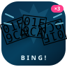

<p align="center">
  
</p>

<h1 align="center">冰冰冰 · 审批提醒</h1>

<p align="center">
  <a href="https://github.com/yuyan-swift/dsh-ice-approval-alert/actions/workflows/check.yml"></a>
  <a href="LICENSE"></a>
</p>

一个 DSH 右侧栏插件：**每次出现审批，先用“冰冰冰”冰你一下；5 分钟、10 分钟、15 分钟各再补一下；15 分钟后自动闭嘴。**

默认开启，不需要额外配置。图标是三颗歪歪扭扭的 🧊🧊🧊。

## 它做什么

| 时间 | 行为 |
| --- | --- |
| 审批出现时 | 播放一声“冰冰冰”（三连清脆冰响） |
| 第 5 分钟 | 还没处理，再冰一下 |
| 第 10 分钟 | 还没处理，继续冰 |
| 第 15 分钟 | 最后一声，然后停止提醒 |
| 审批被允许 / 拒绝 / 撤回 | 立即停止该审批的所有后续提醒 |

- 5 / 10 / 15 分钟都从审批出现的那一刻开始计时。
- 如果 15 分钟内你处理了审批，后面的提醒会取消。
- 如果电脑睡眠 / 页面被后台节流，醒来后最多补响一次，不会把错过的 5、10、15 分钟连续轰炸一遍。
- 同时有多个审批时，每个审批各自计时；侧边栏会显示“另外 N 个审批也在排队”。

## 侧边栏在哪里

DSH 右侧栏 → 引导页里的 **“冰冰冰 · 审批提醒”** 卡片。

面板里有：

- **总开关**：默认开启；关掉后不再响，审批记录也不再计时。
- **音量滑杆**：独立于 DSH 其他声音。
- **试听按钮**：随时听一下“冰冰冰”。
- **提醒节奏**：显示当前审批已经等了几分钟、下一次什么时候响、4 声是否响完。
- **最近提醒**：最近 8 条提醒记录，只保存在当前页面内存里。

## 安装

### Web 版：从 GitHub 安装

```powershell
dsh plugin --profile web add github:yuyan-swift/dsh-ice-approval-alert
```

重启 `dsh web`，再按 `Ctrl+F5` 刷新页面。

### Web 版：从本地目录安装

```powershell
dsh plugin --profile web add link:"<插件目录绝对路径>"
```

`link:` 是软链安装，之后修改源码会直接生效；移动目录后需要重新 `add` 一次。

### 桌面版

桌面端的 `desktop` profile 由 Electron 应用管理，CLI 不接受 `dsh plugin --profile desktop`。推荐：

1. 下载 [Release](https://github.com/yuyan-swift/dsh-ice-approval-alert/releases) 里的 zip；
2. 解压到一个固定目录；
3. 用 DeepSeek Harness 应用内的插件管理器选择本地目录安装；
4. 完全退出并重新打开应用。

如果手动安装，profile 的 `package.json` 需要包含：

```json
{
  "dependencies": {
    "dsh-ice-approval-alert": "link:<插件目录绝对路径>"
  },
  "dsh": {
    "profile": {
      "bundles": ["dsh-ice-approval-alert"]
    }
  }
}
```

> `package.json` 里的 `"private": true` 只用于防止误发 npm，不影响 GitHub 开源和本地安装。

## 关于“冰冰冰”音效

“冰冰冰”是中文互联网上对一种**连续三下、清脆又有点电子感的“冰、冰、冰”剪辑音效**的拟声吐槽，常见于游戏 / 搞笑短视频；它没有一个统一的官方音频文件，很多视频用的都是同一类三连冰响素材。参考：

- [梗Wiki：冰冰冰](https://cnmeme.wiki/entry/%E5%86%B0%E5%86%B0%E5%86%B0)
- [Bilibili：我了叹是什么梗？我了叮、冰冰冰](https://www.bilibili.com/video/BV1Qq8q6qEGx/)

为了不让插件依赖外链、也避免直接打包来源不明的网络音频，本插件用 Web Audio **实时合成**了一个同风格的三连“冰”响：

- 三下高频、短促的玻璃 / 铃铛质感的 “bing”；
- 每一下带一点下坠的“boing”和冰裂噪声；
- 三下左右声像轻微跳动，最后一下升个小三度，听起来更像在催你。

它是原创合成音，不是某个视频里的原声采样。

## 实现方式

- 通过 `MutationObserver` 监听审批卡片 `[data-approval-key]` 的出现与消失，不拦截、不修改审批流程。
- 使用 `localStorage` 保存开关和音量，键名 `dsh.ice-approval-alert.v1`。
- 使用 Web Audio API 合成并播放，无网络请求、无外部音频文件。
- 页面隐藏、窗口失焦、睡眠唤醒后会重新对时，避免计时漂移。

## 隐私与安全

- 只监听审批卡片的出现和消失；不上传审批内容，不联网。
- 审批标题只在本地内存和侧边栏里显示，用于告诉你“在等什么”。
- 不读取凭证、不访问文件系统、不执行命令。
- 详细说明见 [SECURITY.md](SECURITY.md)。

## 开发

```powershell
node --check client.js
node --check index.js
```

插件是纯浏览器模块，没有构建步骤。修改 `client.js` 后，Web 端重启 `dsh web` 并刷新即可。

## 文件

```text
dsh-ice-approval-alert/
├─ package.json
├─ cordis.patch.yml
├─ index.js          # host 半区（不注册行）
├─ client.js         # 侧边栏面板 + 审批监听 + 音效引擎
├─ icon.svg          # 三颗 🧊🧊🧊
├─ README.md
├─ LICENSE
├─ CHANGELOG.md
├─ SECURITY.md
└─ .github/workflows/check.yml
```

## License

[MIT](LICENSE)
